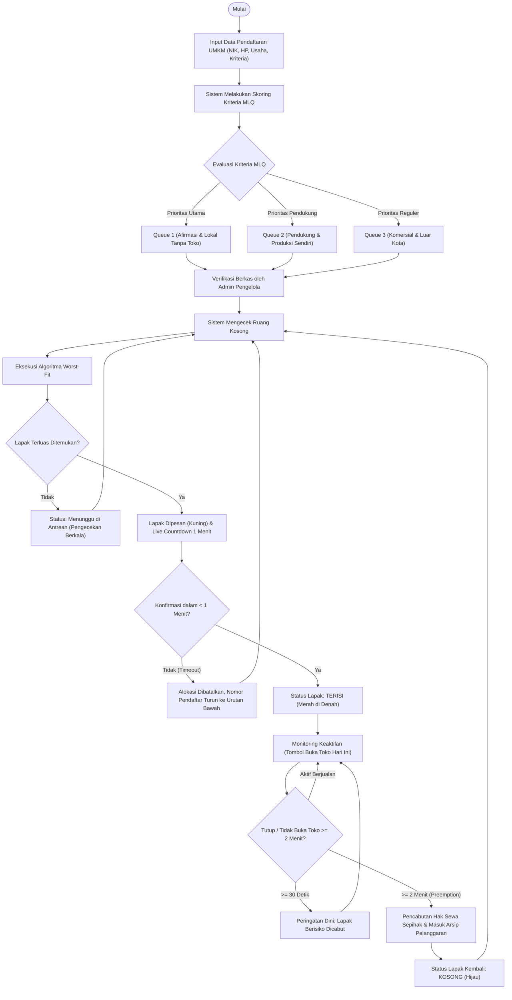
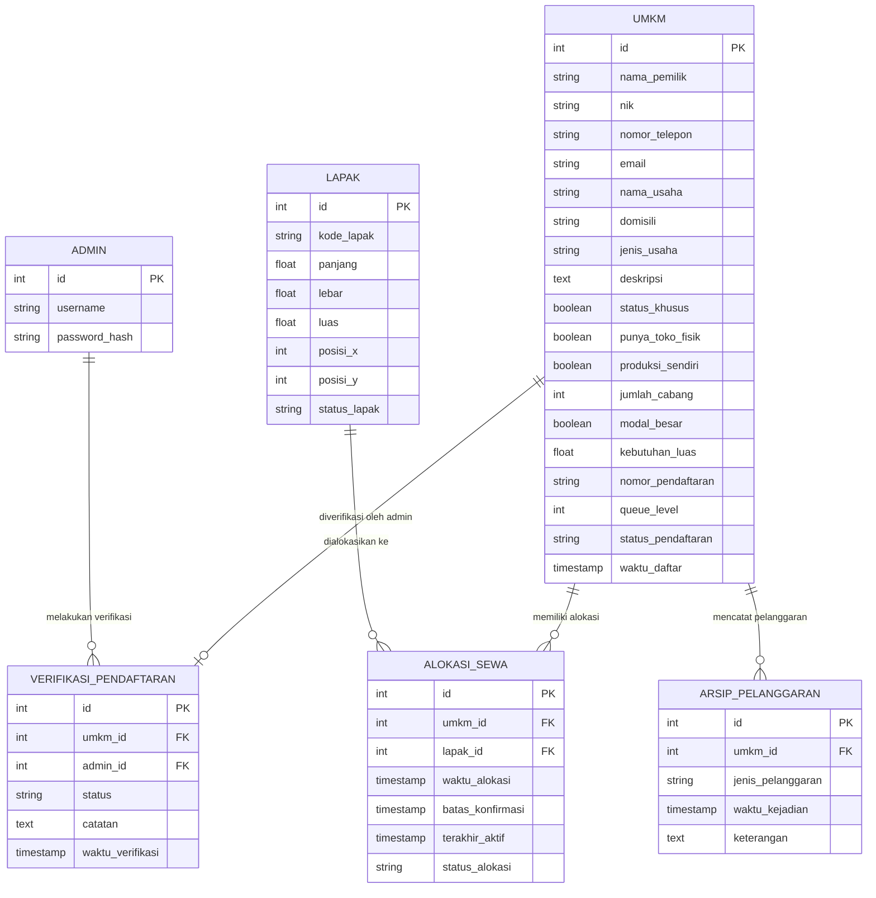

# SI-TAKAR (Sistem Tata Kelola Pasar Seni Kota)

> **Implementasi Konsep Sistem Operasi (Operating System) dalam Tata Kelola Alokasi Lapak Pasar Seni Berbasis Keadilan Sosial.**

SI-TAKAR adalah aplikasi web yang dirancang untuk mengelola pendaftaran, alokasi lahan, verifikasi berkas, dan pengawasan aktivitas lapak UMKM di Pasar Seni Kota. Sistem ini mengadopsi prinsip-prinsip komputasi modern dari Sistem Operasi: **Multilevel Queue (MLQ) Scheduling**, **Worst-Fit Memory Allocation**, serta **Penanganan Deadlock (Timeout 1 Menit & Preemption)**.

---

## 📌 Ringkasan Konsep Sistem Operasi yang Diterapkan

| Konsep OS | Penerapan di SI-TAKAR | Nilai Keadilan & Penggunaan |
| :--- | :--- | :--- |
| **Multilevel Queue (MLQ)** | Pengelompokan pendaftar otomatis ke dalam 3 antrean prioritas (**Queue 1, 2, 3**) berdasarkan kriteria afirmasi & kapasitas usaha. | Mengubah sistem konvensional *First-Come First-Serve* (siapa cepat dia dapat) menjadi sistem berbasis **Keadilan Sosial**. |
| **Worst-Fit Allocation** | Pencocokan otomatis pendaftar prioritas teratas dengan lapak kosong berdimensi/luas terbesar yang tersedia. | Memaksimalkan kepuasan ruang bagi pengrajin kriya dan pelaku usaha prioritas. |
| **Deadlock 1: Timeout (1 Menit)** | Countdown otomatis **1 menit (60 detik)** sejak lapak dialokasikan untuk menunggu konfirmasi penyewa (kebutuhan demonstrasi/simulasi). | Mencegah lapak macet pada fase pemesanan tanpa kepastian. Jika batas waktu habis tanpa konfirmasi, hak dibatalkan otomatis dan dialihkan ke pendaftar berikutnya. |
| **Deadlock 2: Preemption (2 Menit)** | Monitoring keaktifan kios dengan batas maksimal **2 menit (120 detik)** tidak aktif (peringatan dini pada 30 detik). | Mencegah penelantaran kios di pasar. Jika melanggar, hak sewa dicabut paksa sepihak dan dicatat di Arsip Pelanggaran. |

---

## 🔄 Alur Kerja Sistem (4 Fase Siklus Lapak)



---

## 👥 Hak Akses & Aktivitas Berdasarkan Role

Sistem memiliki **2 kategori peran (role)** yang saling tersinkronisasi dua arah secara real-time:

### 1. Role Pelaku UMKM / Pendaftar (Pengguna Awam)

Tampilan antarmuka didesain sederhana, komunikatif, dan ramah orang awam dengan panduan langkah demi langkah:

| Halaman | Fitur Utama | Hal yang Dapat Dilakukan |
| :--- | :--- | :--- |
| **Pendaftaran Kios** (`/pendaftaran.html`) | Formulir Pendaftaran Bertahap | • Mengisi data pemilik: **Nama Lengkap**, **NIK (16 digit)**, **Nomor WhatsApp / HP**, **Kota Domisili**, **Email**.<br>• Memilih kategori produk, kebutuhan ukuran kios ($2\times2$m, $2\times3$m, $3\times3$m), dan deskripsi usaha.<br>• Menandai kriteria afirmasi (disabilitas, warga pra-sejahtera, status toko fisik, produk buatan sendiri, jumlah cabang, modal usaha).<br>• Menerima nomor pendaftaran resmi (contoh: `STK-2026-000001`) dan langsung diarahkan ke pelacakan status. |
| **Cek Status Kios** (`/status.html`) | Pelacakan Berkas & Live Countdown | • **Pemeriksaan Cepat:** Tombol 1-klik untuk pendaftar terakhir di perangkat tanpa perlu mengetik ulang kode.<br>• **Sinkronisasi Verifikasi Admin:** Melihat hasil pemeriksaan berkas resmi dari admin (`Terverifikasi` / `Perlu Perbaikan`) beserta **catatan/alasan dari petugas**.<br>• **Live Countdown 1 Menit (Deadlock 1):** Melihat hitung mundur detik per detik saat kios berhasil ditemukan oleh algoritma Worst-Fit.<br>• Menekan tombol **`✓ Setuju & Ambil Kios Sekarang`** sebelum waktu 1 menit habis. |
| **Panel Kios Aktif** (`/status.html` & `/profil.html`) | Absensi & Pencegahan Preemption | • Menekan tombol **`✓ Buka Toko Hari Ini`** setiap kali berjualan untuk mereset durasi tidak aktif ke 0 detik.<br>• Memantau meteran durasi tidak aktif ($0$ s/d $120$ detik).<br>• Menerima peringatan dini (*Warning*) jika toko tutup lebih dari 30 detik. |

---

### 2. Role Admin / Pengelola Pasar Seni

Admin bertugas memvalidasi berkas pendaftar dan memantau tata ruang pasar. Seluruh input user dibaca oleh admin, dan keputusan admin langsung tampil di layar user:

| Tab Menu Dashboard | Fitur Utama | Hal yang Dapat Dilakukan |
| :--- | :--- | :--- |
| **📋 Verifikasi Pendaftar & Berkas** (`/admin.html`) | Validasi Berkas Lengkap Dua Arah | • Membaca seluruh data yang diinputkan user: **NIK, No HP/WA (bisa diklik untuk telepon/chat), Email, Domisili, Kebutuhan Luas, Tag Kriteria Afirmasi, serta Deskripsi Usaha**.<br>• Memberikan catatan evaluasi di kolom input catatan verifikasi.<br>• Menekan tombol **`✓ Setujui Verifikasi`** atau **`⚠️ Perlu Perbaikan`** (hasil keputusan dan catatan langsung tersinkronisasi ke halaman status user secara real-time). |
| **🏢 Peta Denah Kios (Live Grid)** (`/admin.html`) | Denah Interaktif Real-Time | • Memantau visualisasi denah pasar dengan 3 kode warna:<br>&nbsp;&nbsp;🟢 **Hijau (Kosong):** Tersedia untuk dialokasikan Worst-Fit.<br>&nbsp;&nbsp;🟡 **Kuning (Dipesan):** Menunggu konfirmasi pendaftar ($< 1$ menit).<br>&nbsp;&nbsp;🔴 **Merah (Terisi):** Kios resmi aktif berjualan.<br>• Menambah kios baru ke denah (kode lapak, panjang, lebar, koordinat X dan Y). |
| **👥 Antrean Prioritas (MLQ)** (`/admin.html`) | Pemantauan Multilevel Queue | • Memantau daftar pendaftar di masing-masing kolom (**Queue 1: Afirmasi**, **Queue 2: Pendukung**, **Queue 3: Reguler**).<br>• Melihat grafik komposisi antrean dan kapasitas penggunaan pasar. |
| **⏱️ Simulasi Deadlock (1 Menit)** (`/admin.html`) | Eksekusi & Riwayat Log Deadlock | • Melihat riwayat pembatalan otomatis akibat **Timeout 1 Menit**.<br>• Melihat riwayat pencabutan hak sewa akibat **Preemption** ($> 2$ menit tidak aktif).<br>• Menekan tombol **`⚡ Jalankan Pemeriksaan Deadlock Sekarang`** untuk memicu evaluasi manual secara instan di samping cron otomatis setiap 3 detik. |

---

## 📐 Kriteria Pembagian Antrean Multilevel Queue (MLQ)

1. **Queue 1: Prioritas Utama (Jalur Afirmasi & Pelestarian)**
   - **Target:** Pengrajin lokal asli, UMKM rentan, dan penyandang disabilitas.
   - **Syarat:** Warga lokal (Kabupaten/Kota lokasi pasar), produk kerajinan tangan/kriya/seni rupa/barang antik buatan sendiri, dan belum memiliki toko/ruko fisik pribadi (baru merintis).
   - **Status Khusus:** Penyandang disabilitas atau warga pra-sejahtera (bansos / janda pencari nafkah utama) **mengunci posisi Queue 1** bagi warga lokal.
   - *Dihabiskan pertama kali oleh sistem sebelum antrean lain diproses.*

2. **Queue 2: Prioritas Menengah (Jalur Pendukung Ekosistem)**
   - **Target:** Pelaku usaha kuliner, fesyen, aksesoris, atau jasa kreatif lokal yang melengkapi pengalaman pengunjung pasar seni.
   - **Syarat:** Warga lokal, produk diproduksi sendiri (industri rumahan lokal), atau pengrajin kriya lokal yang sudah memiliki toko fisik pribadi.
   - *Baru diproses oleh sistem jika seluruh pendaftar di Queue 1 telah memperoleh lapak.*

3. **Queue 3: Prioritas Reguler (Jalur Komersial & Ekspansi)**
   - **Target:** Pedagang dari luar daerah, reseller barang pabrik, franchise (waralaba), produk impor, toko cabang $>1$, atau usaha bermodal besar (> 50 juta).
   - *Berfungsi sebagai buffer/cadangan dan hanya menerima alokasi jika masih ada sisa lapak setelah Queue 1 dan Queue 2 terpenuhi.*

---

## 🗄️ Entity Relationship Diagram (ERD)



---

## 🚀 Panduan Menjalankan Aplikasi

### 1. Inisialisasi Data Awal (Pertama Kali)
Untuk membuat 12 lapak contoh pada denah pasar serta akun pengelola bawaan:

```powershell
.\.venv\Scripts\python seed.py
```
> **Akun Default Admin Pengelola:** Username: `admin` | Password: `admin123`

### 2. Jalankan Server Web
Jalankan server FastAPI dengan Uvicorn:

```powershell
.\.venv\Scripts\uvicorn main:app --reload
```

Aplikasi dapat dibuka langsung di peramban (browser):
- **Beranda Publik:** `http://localhost:8000`
- **Form Pendaftaran UMKM:** `http://localhost:8000/pendaftaran.html`
- **Cek Status Kios & Konfirmasi (1 Menit):** `http://localhost:8000/status.html`
- **Dashboard Pengelola Pasar (Admin):** `http://localhost:8000/admin.html`

### 3. Jalankan Pengujian Otomatis
Untuk memvalidasi integritas logika MLQ, alokasi Worst-Fit, verifikasi admin dua arah, dan simulasi Deadlock:

```powershell
.\.venv\Scripts\pytest
```
Semua 12 test suite teruji lulus secara otomatis.
